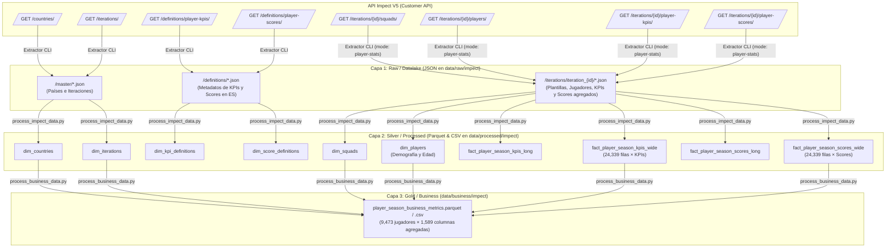
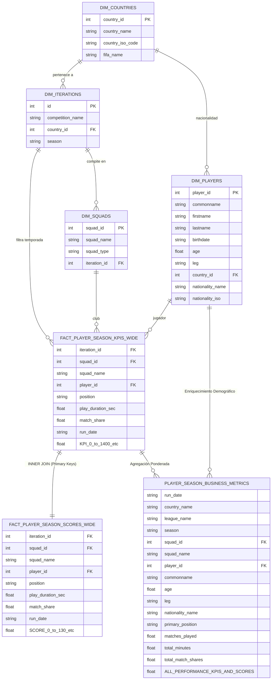

# Documentación Técnica del Pipeline de Datos Impect API V5 (Arquitectura de Temporada Agregada)

---

## 1. Visión General de la Arquitectura

El pipeline de datos de **Impect API V5** ha sido diseñado bajo una arquitectura analítica modular en tres capas (**Raw / Datalake**, **Silver / Processed** y **Gold / Business**). Su objetivo fundamental es extraer, transformar, modelar y agregar estadísticas avanzadas de rendimiento (*KPIs* y *Scores*) y metadatos demográficos de jugadores a nivel **Temporada / Iteración** (`player-season-stats`), proporcionando un conjunto de datos consolidado, normalizado y matemáticamente preciso para la construcción de modelos analíticos, de *scouting* y comparativos.



---

## 2. Flujo Detallado por Capas

### Capa 1: Ingesta Raw (Datalake)
El módulo de extracción (`scripts/impect_api/`) interactúa con la API V5 (`https://api.impect.com/v5/customerapi`) utilizando autenticación por **Token Bearer** (`IMPECT_TOKEN`). La ingesta se orquesta mediante el script de consola `run_extraction.py` configurado en el modo por defecto `--mode player-stats`.

**Almacenamiento particionado:**
Todos las respuestas crudas de la API se guardan en formato `.json` manteniendo la fidelidad de origen dentro de una estructura particionada por fecha de ejecución:
`data/raw/impect/run_date=YYYY-MM-DD/`

1. **Catálogo Maestro (`/master/`):**
   - `countries.json`: Listado global de países (ID, código ISO, nombre FIFA).
   - `iterations.json`: Listado global de temporadas/competiciones accesibles con su respectiva estructura de jerarquía (`competition.countryId`, `competition.name`, `season`).
2. **Definiciones (`/definitions/`):**
   - `kpis_es.json`: Catálogo de variables de rendimiento KPI en español (nombre técnico, etiqueta, definición, significado, si es métrica invertida).
   - `player_scores_es.json`: Catálogo de índices ponderados *Player Scores* en español.
3. **Datos por Iteración (`/iterations/iteration_{id}/`):**
   - `squads.json`: Clubes participantes en la temporada.
   - `players.json`: Catálogo general de jugadores registrados en esa competición (incluye fecha de nacimiento, pierna hábil y nacionalidad principal).
   - `all_squads_player_kpis.json`: Valores consolidados de todos los KPIs para todos los jugadores en la temporada (`GET /iterations/{id}/player-kpis`).
   - `all_squads_player_scores.json`: Valores consolidados de todos los *Player Scores* (`GET /iterations/{id}/player-scores`).

> [!IMPORTANT]
> **Por qué se eliminó la extracción a nivel partido (`--mode matches` / `--mode daily`):**  
> La API de Impect pre-calcula los valores de temporada dividiéndolos entre la cuota de partido (*matchShare*), normalizando las estadísticas a **tasa por 90 minutos de juego**. Descargar los datos agregados por iteración reduce en más del 95% el volumen de llamadas de red y el peso de almacenamiento, garantizando que el modelo analítico consuma el valor exacto validado por Impect.

---

### Capa 2: Procesamiento Silver (`process_impect_data.py`)
El script `scripts/impect_api/process_impect_data.py` lee los archivos JSON de la partición Raw más reciente y construye tablas normalizadas en formatos **Parquet** (alta compresión y velocidad de lectura para Python/Pandas) y **CSV** (auditoría visual).

#### Dimensiones Generadas
- `dim_countries`: Mapeo de `country_id` hacia `country_name`, `country_iso_code` y `fifa_name`.
- `dim_iterations`: Detalle de `id`, `competition`, y `season`.
- `dim_squads`: Identificadores únicos del club por iteración (`squad_id`, `squad_name`, `iteration_id`).
- `dim_players`: Catálogo maestro unificado de jugadores (`player_id`, `commonname`, `firstname`, `lastname`, `birthdate`, `age` [calculado dinámicamente en años], `leg`, `country_id`, `nationality_name`, `nationality_iso`).
- `dim_kpi_definitions` / `dim_score_definitions`: Diccionarios analíticos para documentar qué representa cada columna.

#### Tablas de Hechos (Facts)
Para cada registro en `all_squads_player_kpis.json` y `all_squads_player_scores.json`, el procesador genera dos representaciones:
1. **Formato Long (`fact_player_season_kpis_long` y `fact_player_season_scores_long`):**  
   Estructura vertical (`iteration_id`, `squad_id`, `player_id`, `position`, `kpi_id`, `value`). Contiene **>13.6 millones de filas** en total, ideal para consultas relacionales puras en bases de datos SQL.
2. **Formato Wide (`fact_player_season_kpis_wide` y `fact_player_season_scores_wide`):**  
   Estructura pivotal lista para modelado (`24,339 filas`). Cada columna representa una métrica técnica o táctica (ej: `BYPASSING_PACKED_OPPONENTS`, `DRIBBLE_SUCCESS`, `OFFENSIVE_INDEX`), con índices base:
   `[iteration_id, squad_id, squad_name, player_id, position, play_duration_sec, match_share, run_date]`

---

### Capa 3: Transformación Gold / Business (`process_business_data.py`)
El script `scripts/impect_api/process_business_data.py` se encarga del modelado de negocio final para la ciencia de datos. Su propósito es responder a la necesidad de analizar al jugador en su contexto de **País, Liga, Temporada y Club**, resolviendo el desafío técnico de **jugadores multi-posición** dentro de una misma temporada.

#### 1. Cruce y Enriquecimiento de Datos
Se ejecuta un `INNER JOIN` entre las tablas `fact_player_season_kpis_wide` y `fact_player_season_scores_wide` sobre sus llaves primarias, y posteriormente se enriquecen con metadatos mediante `LEFT JOIN` con las dimensiones:
- Desempaquetado de `competition` de `dim_iterations` $\rightarrow$ `league_name` y `country_id`.
- Cruce con `dim_countries` $\rightarrow$ `country_name`.
- Cruce con `dim_players` $\rightarrow$ `commonname`, `age`, `leg`, `nationality_name`.

#### 2. Agregación Matemáticamente Correcta (Promedio Ponderado por Cuota de Partido)
Un jugador puede jugar como mediocentro defensivo (`DEFENSIVE_MIDFIELD`) en 15 partidos y como lateral derecho (`RIGHT_BACK`) en 5 partidos durante una temporada. En la capa Silver, esto aparece como dos filas distintas con diferentes `match_share` y diferentes valores por 90 minutos en cada KPI.

Para agrupar la información por `[country_name, league_name, season, squad_id, player_id]` en **una única fila analítica por jugador en el club**, el procesador aplica la siguiente matemática:

1. **Ponderación previa por volumen:**  
   Para cada métrica de rendimiento $M_i$:
   $$\text{Métrica Ponderada}_i = M_i \times \text{match\_share}$$

2. **Sumatoria agregada por grupo:**  
   Al agrupar por jugador/club, se suman los valores ponderados, junto con la suma total de `play_duration_sec` y `match_share`:
   $$\text{Suma Ponderada}_i = \sum (M_i \times \text{match\_share})$$
   $$\text{Total Match Share} = \sum \text{match\_share}$$
   $$\text{Total Segundos} = \sum \text{play\_duration\_sec}$$

3. **Cálculo de Promedio Final por 90 Minutos:**  
   Se divide la suma ponderada entre el total de cuota de partido acumulada:
   $$\text{Tasa Final por 90 Minutos}_i = \frac{\text{Suma Ponderada}_i}{\text{Total Match Share}}$$

4. **Variables de Volumen Proxy:**
   - `matches_played`: Redondeo de `total_match_shares` (representa el número equivalente de partidos completos de 90 minutos disputados).
   - `total_minutes`: Redondeo de $\frac{\text{Total Segundos}}{60}$.
   - `primary_position`: Moda estadística (`mode()`) de las posiciones en las que participó el jugador.

---

## 3. Modelo de Relación de Entidades (ERD)

El siguiente diagrama muestra el modelo relacional entre las dimensiones de la capa Silver y el conjunto de datos de hechos consolidado en la capa Business:



---

## 4. Estructura de la Tabla Final (`player_season_business_metrics.parquet`)

La tabla final producida en `data/business/impect/player_season_business_metrics.parquet` se compone de **1,589 columnas**, ordenadas de forma semántica para facilitar su exploración inmediata:

| Grupo de Columnas | Nombre del Campo | Tipo | Descripción |
| :--- | :--- | :---: | :--- |
| **Metadatos de Ejecución** | `run_date` | `string` | Fecha en la que se ejecutó la ingesta (`YYYY-MM-DD`). |
| **Jerarquía de Competición** | `country_name` | `string` | Nombre del país del torneo (ej: `Colombia`, `Brazil`, `Argentina`). |
| | `league_name` | `string` | Nombre oficial de la liga (ej: `Liga Dimayor I`, `Campeonato Brasileiro Série A`). |
| | `season` | `string` | Año o nombre de la temporada (ej: `2024`, `2025`, `2026`, `25/26`). |
| **Club y Jugador** | `squad_id` | `int` | Identificador único del equipo en Impect. |
| | `squad_name` | `string` | Nombre comercial de la plantilla / club (ej: `Independiente Medellín`). |
| | `player_id` | `int` | Identificador único del futbolista. |
| | `commonname` | `string` | Nombre común u oficial del futbolista. |
| **Demografía** | `age` | `float` | Edad calculada en años al momento del procesamiento de los datos. |
| | `leg` | `string` | Pierna hábil (`RIGHT`, `LEFT`, `BOTH`). |
| | `nationality_name` | `string` | País de nacionalidad principal del jugador. |
| **Volumen y Posición** | `primary_position` | `string` | Posición en la que disputó mayor cantidad de cuota de partido en la temporada (`mode`). |
| | `matches_played` | `float` | Proxy de partidos jugados de 90 min (`total_match_shares` redondeado a 1 decimal). |
| | `total_minutes` | `float` | Minutos reales en campo (`total_play_duration_sec / 60`). |
| | `total_match_shares`| `float` | Cuota total exacta de partido acumulada por el jugador en la temporada. |
| **Rendimiento Táctico (KPIs)** | `BYPASSING_PACKED...`<br>`BALL_RECOVERIES...`<br>*(y 1,400+ KPIs)* | `float` | Tasa promedio de rendimiento por 90 minutos de juego, ponderada de forma exacta por las cuotas de partido de cada posición en las que actuó. |
| **Rendimiento Ponderado (Scores)**| `OFFENSIVE_INDEX...`<br>`DEFENSIVE_INDEX...`<br>*(y 130+ Scores)* | `float` | Índices compuestos globales del rendimiento del jugador por 90 minutos. |

---

## 5. Guía Operativa y Ejecución

Para ejecutar o programar el pipeline mes a mes para actualizar las estadísticas analíticas:

### 1. Ingesta desde la API V5 (Raw Datalake)
Descargar las estadísticas actualizadas de los jugadores para un conjunto específico de iteraciones (`--iterations ID1 ID2 ...`):
```bash
source .venv/bin/activate

# Ejemplo: Extraer catálogos maestros y datos de temporada para ligas de América
python3 scripts/impect_api/run_extraction.py \
    --mode player-stats \
    --iterations 866 1207 1752 1396 1794 1799 1800 1801 1802 1813 1823 1863 1864 1929 1930 1973 2176
```

### 2. Procesamiento y Modelado (Silver & Gold)
Ejecutar los procesadores en secuencia para actualizar automáticamente las tablas en Parquet/CSV:
```bash
# Paso A: Transformar JSONs crudos del datalake hacia la capa Silver (Processed)
python3 scripts/impect_api/process_impect_data.py

# Paso B: Generar la tabla analítica final de negocio (Gold)
python3 scripts/impect_api/process_business_data.py
```

### 3. Carga en Pandas / Python para Modelos Analíticos
```python
import pandas as pd

# Cargar la tabla final directamente (tiempo de lectura < 1 segundo en Parquet)
df_business = pd.read_parquet("data/business/impect/player_season_business_metrics.parquet")

# Ejemplo: Filtrar centrales en la Liga Dimayor con más de 1,000 minutos jugados
df_colombia_cbs = df_business[
    (df_business["country_name"] == "Colombia") &
    (df_business["primary_position"] == "CENTRAL_DEFENDER") &
    (df_business["total_minutes"] >= 1000.0)
]

print(df_colombia_cbs[["commonname", "squad_name", "age", "matches_played", "total_minutes"]].head())
```
